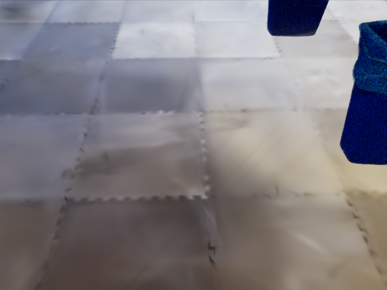
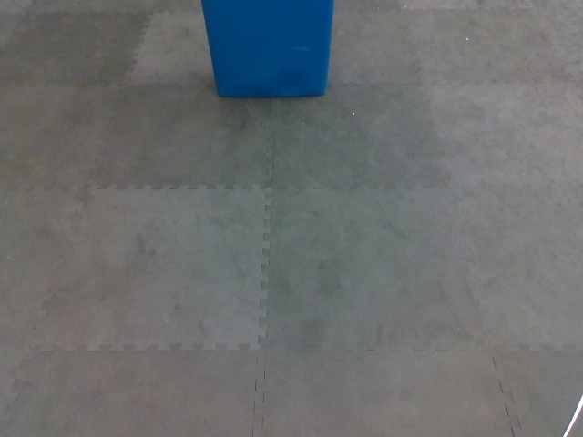
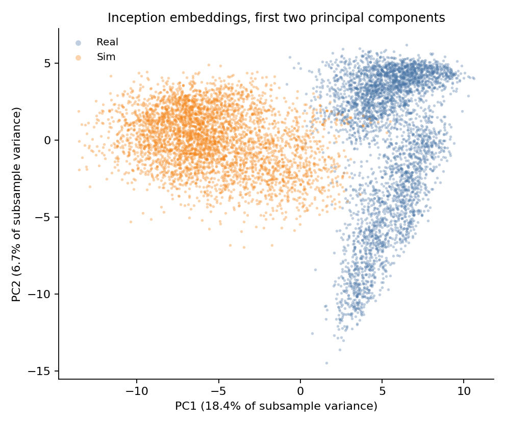
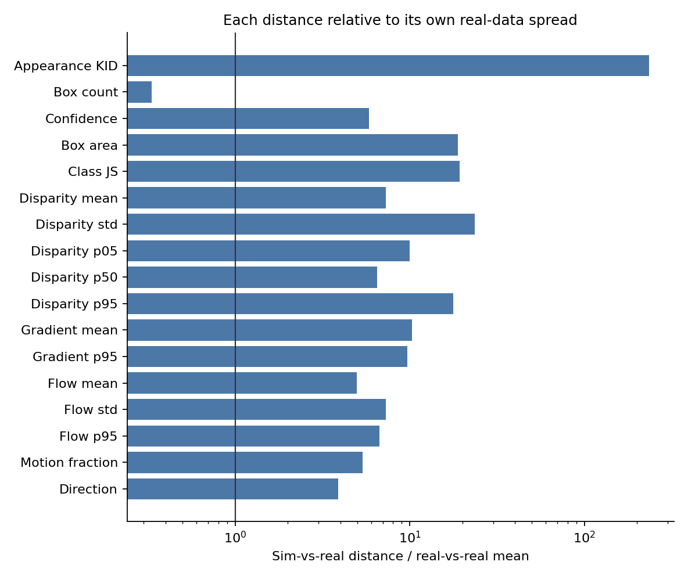
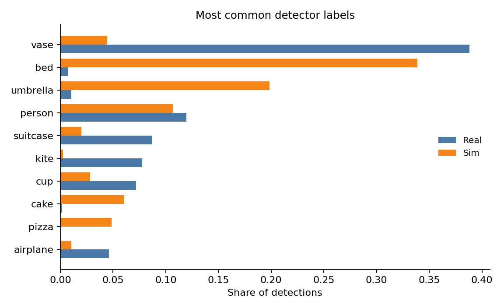
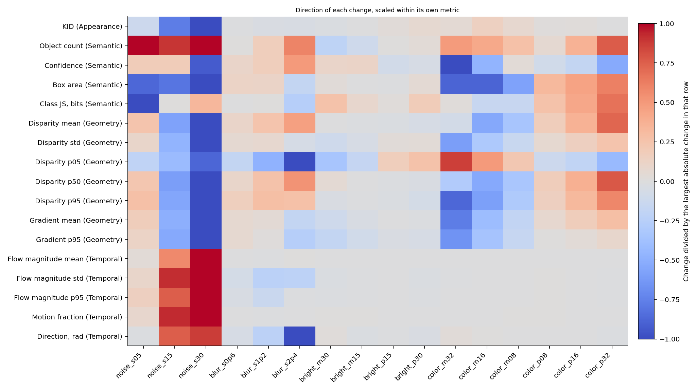

# A Simulator-Agnostic Framework for Distribution-Based Visual Realism Evaluation

This project measures the visual gap between simulation RGB and real RGB without pairing frames and without reducing that gap to one score. The robot is a Unitree G1. Simulation images come from Isaac Sim. Real images come from one physical platform. After the images are on disk, the evaluation never calls the simulator.

The comparison is unpaired. Each trajectory is one episode, stored as a `uint8` tensor of shape `(T, 480, 640, 3)` at a declared 15 fps. Both domains contain episodes `0` through `156`.

| | Simulation | Real |
|---|---:|---:|
| Episodes | 157 | 157 |
| Frames | 31,526 | 11,963 |
| Duration at 15 fps | 2,102 s | 798 s |
| Frames per episode | 44–503, mean 201 | 35–355, mean 76 |

<p align="center">
  
  &nbsp;
  
</p>

<p align="center"><em>Episode 0. Left: simulation. Right: real. Both cameras look down at interlocking foam tiles and a blue bin. The images are not frame-aligned.</em></p>

## What is measured

Four distances are reported separately. A smaller value means the two distributions are closer. KID, Wasserstein, and Jensen–Shannon do not share a unit, so they are not averaged and not ranked against each other by raw magnitude.

| Family | Representation | Distance |
|---|---|---|
| Appearance | InceptionV3, 2048-d, no center crop | Unbiased polynomial KID, kernel `(x·y / 2048 + 1)^3` |
| Semantic | YOLOv8n, confidence 0.25 | Wasserstein on count, confidence, and box area; Jensen–Shannon on class frequencies |
| Geometry | MiDaS DPT-Large disparity, larger means closer | Wasserstein on the frame statistics below |
| Temporal | Farneback flow inside one episode | Wasserstein on magnitude; circular Wasserstein on direction |

Count includes frames with no box. Confidence and box area use detected boxes only. Class names are COCO responses of a detector that was not trained on this floor scene. A “bed” or “vase” label is not an inventory of the room. MiDaS values are not meters. Flow is image motion, not robot speed.

Uncertainty is computed by resampling whole trajectories, not frames. The baseline uses 200 draws. Real-vs-real is the mean distance between 50 random halves of the real episodes. It describes spread inside this collection. It is not a universal realism cutoff.

## Baseline

On the original images, appearance is far outside the spread of the real data. KID is **0.236**. Random halves of the real trajectories sit near **0.001**. The two-dimensional view below is only an illustration: the first two principal components explain 25.1% of the variance in a balanced 4,000-frame subsample. The quantitative appearance result is the KID.

<p align="center">
  
</p>

<p align="center"><em>Inception embeddings. Orange is simulation, blue is real. Equal sample size per domain.</em></p>

The figure below divides each sim-to-real distance by the mean distance between random halves of the real data. The vertical line is 1. A bar to the right means the cross-domain distance is larger than the internal spread of that same metric. Bars are not comparable across metrics.

<p align="center">
  
</p>

| Distance | Sim vs real | Real vs real | Ratio |
|---|---:|---:|---:|
| KID (Appearance) | 0.2360 | 0.00101 | 235 |
| Object count (Semantic) | 0.00956 | 0.0287 | 0.33 |
| Confidence (Semantic) | 0.0733 | 0.0125 | 5.8 |
| Box area (Semantic) | 0.409 | 0.0217 | 19 |
| Class JS, bits (Semantic) | 0.563 | 0.0292 | 19 |
| Disparity mean (Geometry) | 1.87 | 0.257 | 7.3 |
| Disparity std (Geometry) | 2.05 | 0.0875 | 23 |
| Disparity p05 (Geometry) | 2.14 | 0.214 | 10 |
| Disparity p50 (Geometry) | 2.04 | 0.314 | 6.5 |
| Disparity p95 (Geometry) | 4.16 | 0.234 | 18 |
| Gradient mean (Geometry) | 0.109 | 0.0106 | 10 |
| Gradient p95 (Geometry) | 0.132 | 0.0136 | 9.7 |
| Flow magnitude mean (Temporal) | 0.574 | 0.115 | 5.0 |
| Flow magnitude std (Temporal) | 2.01 | 0.276 | 7.3 |
| Flow magnitude p95 (Temporal) | 4.87 | 0.725 | 6.7 |
| Motion fraction (Temporal) | 0.0426 | 0.00795 | 5.4 |
| Direction, rad (Temporal) | 0.239 | 0.0613 | 3.9 |

Object count is the exception. Both domains leave about 72% of frames empty, and the count distance falls inside the real-vs-real spread. The detector fires at a similar rate. What it returns does not match: simulation boxes pile up near the full frame, and the leading labels differ.

<p align="center">
  
</p>

<p align="center"><em>Share of detections, not of frames. Simulation responses are led by bed and umbrella. Real responses are led by vase.</em></p>

Geometry separates more in the shape of the disparity map than in its mean. The within-frame standard deviation is 23 times its real-vs-real mean. The upper tail moves with it. Temporal magnitude and direction also exceed their within-domain references. Part of that gap is how the camera moved. The trajectories were not paired in time, and simulation episodes are longer, so a pooled frame estimate gives long episodes more weight. The confidence interval resamples episodes.

Full intervals, sim-vs-sim diagnostics, and distribution plots are in [`cv_project/features/phase4_report.md`](cv_project/features/phase4_report.md).

## Single-factor ablation

The ablation changes one visual factor at a time on simulation episodes 0–53 (54 trajectories, 11,054 frames) and compares each condition with the original real set. The real images are never edited. The baseline for the change is the unperturbed version of these same 54 episodes, not the 157-episode table above. On that subset the KID is 0.234.

Sixteen levels, never stacked:

| Factor | Levels | What stays fixed across frames |
|---|---|---|
| Gaussian noise | σ = 5, 15, 30 | A new draw on every frame, seeded by episode id |
| Gaussian blur | σ = 0.6, 1.2, 2.4 px | The same kernel |
| Brightness | −30, −15, +15, +30 | The same additive shift |
| Color temperature | ±8, ±16, ±32 | R and B move in opposite directions; G is unchanged |

<p align="center">
  
</p>

<p align="center"><em>Blue: that distance became smaller. Red: it became larger. Each row is scaled by its own largest change, so color depth cannot be compared across rows.</em></p>

Noise at σ = 15 and 30 lowers KID to 0.160 and 0.137, and both intervals sit below the subset baseline. The same noise is drawn independently on every frame, so mean flow rises from 0.53 px/frame to 10.3 and 17.6. A smaller KID here is a statement about one metric. It is not a claim that the image became more realistic.

Blur, brightness, and color temperature leave KID inside the trajectory interval of the original simulation. Shifting brightness by −15, the step closest to the mean gap of about 14 levels, leaves KID at 0.234. Color temperature moves box area and disparity while leaving flow flat, which is the expected signature of a transform that does not flicker. Details are in [`cv_project/features/phase5_report.md`](cv_project/features/phase5_report.md).

## Layout

```text
cv_project/
  phase2/                 feature extraction
  phase3/                 distances, trajectory bootstrap, real-vs-real
  phase4/                 baseline figures
  phase5/                 single-factor perturbations
  features/               phase reports
  results/phase3/         metrics.csv, metrics.json
  results/phase4/figures/
  results/phase5/figures/
```

Written reports:

- [Phase 2, feature extraction](cv_project/features/phase2_report.md)
- [Phase 3, distances and intervals](cv_project/features/phase3_report.md)
- [Phase 4, baseline](cv_project/features/phase4_report.md)
- [Phase 5, ablation](cv_project/features/phase5_report.md)

The earlier Isaac Sim data-collection notes are in [`DATA_COLLECTION.md`](DATA_COLLECTION.md).

## Reproduce

Run the commands from `cv_project/`. Evaluation uses a CUDA PyTorch environment. The simulator environment is not used once the RGB tensors exist.

```text
cd cv_project
set PYTHONPATH=.;.vendor
python -m phase2.extract
python -m phase3.run
python -m phase4.plot_baseline
python -m phase5.extract --limit-episodes 54
python -m phase5.evaluate
python -m phase5.plot_ablation
```

Phase 2 is the expensive step: InceptionV3, YOLOv8n, and MiDaS DPT-Large over both domains. Phase 5 repeats the simulation forward pass once per level. Finished episode files are skipped, so a run can be resumed.
